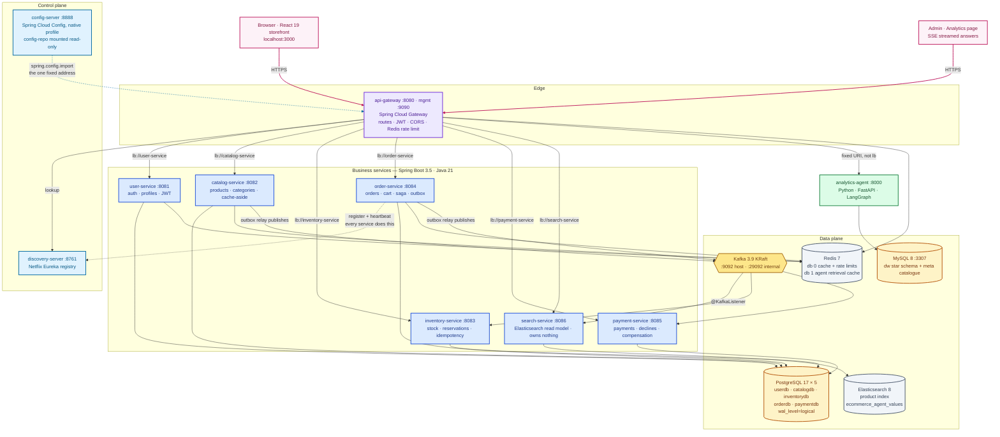
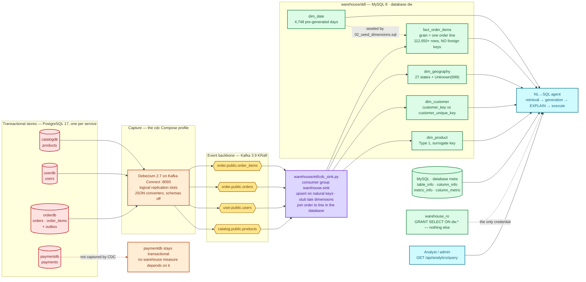
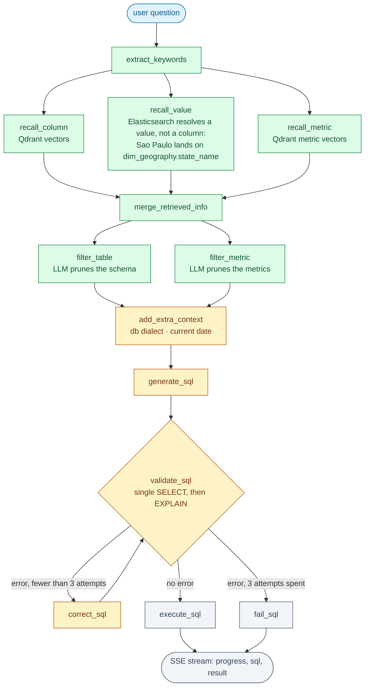

# Commerce Intelligence

**An e-commerce microservices platform with an analytical read path you can query in plain English.**

Nine Spring Boot services run a real storefront on ~481,000 rows of the published
*Brazilian E-Commerce Public Dataset by Olist*. Their transactional writes are captured from the
PostgreSQL write-ahead log by Debezium, streamed over Kafka, transformed into a MySQL star-schema
warehouse, and answered in natural language by a Python LangGraph agent that generates, validates,
self-corrects and executes SQL — served behind the same gateway and the same JWT as everything else.

```
OLTP (PostgreSQL × 5)  ──Debezium──►  Kafka  ──cdc_sink.py──►  Star schema (MySQL 8)  ──►  NL→SQL Agent
     ▲                                                                                          │
     └──────────────────── React storefront + admin analytics, through the API Gateway ─────────┘
```

---

## Table of contents

1. [Project Overview](#1-project-overview)
2. [Architecture & Design](#2-architecture--design)
3. [Component Breakdown](#3-component-breakdown)
4. [Getting Started / Installation](#4-getting-started--installation)
5. [Development & Deployment](#5-development--deployment)
6. [Evaluation & Testing](#6-evaluation--testing)
7. [Documentation Map](#7-documentation-map)

---

## 1. Project Overview

### What it is

Commerce Intelligence is two halves that meet at a warehouse:

* **A transactional platform** — Java 21 / Spring Boot 3.5 microservices, one bounded context per
  service, each owning its own PostgreSQL database. Nothing shares a schema and nothing shares a jar.
  Order placement is a **choreographed saga** over Kafka, made reliable by a **transactional outbox**
  per service.
* **An analytical read path** — a hand-built MySQL star schema, kept fresh by **change data capture**,
  queried by a **metadata-driven NL→SQL agent**. The two halves are joined only by change events;
  there is no database connection between them.

### Core value proposition

| Property | How it is delivered |
|---|---|
| **Ask questions, not queries** | "What was the total revenue by product category in 2018?" becomes validated SQL, streamed live with the pipeline's progress, in ~12 s. |
| **Analytics never touches the checkout path** | Analytical scans hit the warehouse, not the order database. Heavy reads and transactional writes cannot contend. Freshness is measured, not assumed: **median 495 ms** from OLTP commit to warehouse visibility. |
| **Least privilege enforced by the database, not the prompt** | The agent connects as `warehouse_ro`: `SELECT` on `dw.*` and nothing else. A `GRANT` is a boundary; a guardrail is a mitigation. |
| **Real data, real numbers** | Every count in this repository was produced by loading the published Olist CSVs. Row counts match the dataset's published figures exactly: 99,441 orders, 112,650 order items, 32,951 products, 96,096 distinct people. |
| **Integrated, not forked** | The NL→SQL agent is a finished LangGraph service pointed at this warehouse by *configuration*: two config files and one application-code argument. |
| **One command starts everything** | `docker compose up -d` for the data plane; `--profile apps / agent / cdc / observability` composes on top. |

### Target use cases

* **Self-service business analytics** for a merchandising or finance team that cannot write SQL and
  should not wait for an engineer.
* **A reference architecture** for polyglot persistence — PostgreSQL for OLTP, MySQL for OLAP, Kafka
  as the only thing that crosses the gap.
* **A working demonstration of distributed correctness**: outbox + relay, idempotent consumers keyed on
  natural keys, compensating transactions, late-arriving dimensions, and traces that survive the
  asynchronous hop.
* **An LLM-engineering case study**: schema/column/metric/value retrieval before generation, a
  self-correction loop bounded to three attempts, and an execution-accuracy harness that took the
  agent from **78.8 % → 97.0 %** by fixing *metadata*, not the model.

### Measured results

| Metric | Value | Produced by |
|---|---:|---|
| Rows loaded from the real Olist CSVs | **481K** in 24.9 s | `scripts/load_olist.py` |
| Agent execution accuracy | **97.0 %** (32/33), from 78.8 % | `eval/run_eval.py` |
| OLTP commit → warehouse visible (median) | **495 ms** | `scripts/measure_cdc_lag.py` |
| Catalogue write → searchable (median) | **942 ms** | `scripts/measure_search_lag.py` |
| Full search-index rebuild | **263 s** | `POST /api/products/reindex` |
| Order saga, end to end | **~1.3 s** (HTTP returns `PENDING` in ~39 ms) | `scripts/saga_demo.py` |
| Smoke test | **18/18 checks** | `scripts/smoke_test.py` |

All numbers, their methodology and the machine they were measured on are in
[`docs/measurements.md`](docs/measurements.md).

---

## 2. Architecture & Design

### 2.1 Microservices topology

Three planes: a **control plane** (config + discovery), an **edge** (one gateway, one port), and a
**domain** of six business services plus the Python agent. Every service holds exactly one hard-coded
address — the config server's — and learns everything else.



**Why the pieces are there.** `lb://` rather than a fixed host, because a fixed address names one
process and Eureka resolves the live instance set per request. Config Server rather than environment
sprawl, because the same jar must run as a host JVM locally and as a container in Kubernetes, with the
difference being only what the variables resolve to. The gateway rather than direct service ports,
because that is where authentication, CORS and the rate-limit token bucket live — and because
`/actuator/**` is deliberately unrouted, so no path from the edge reaches a service's management
endpoints.

### 2.2 Data flow: OLTP → CDC → warehouse → agent

Each service owns a separate PostgreSQL *container*, not a schema in a shared server — that is what
makes "this service owns its data" physical rather than a convention. Debezium reads each database's
WAL through a logical replication slot; the sink is a hand-written Python consumer, not a JDBC sink,
because a JDBC sink writes a table copy and a warehouse needs a different shape.



Three properties make this a design rather than a pile of components:

1. **Every sink write is an upsert on a natural key.** Kafka is at-least-once and a restart re-reads
   uncommitted offsets, so `INSERT ... ON DUPLICATE KEY UPDATE` against `uk_fact_order_line` is what
   stops a consumer restart from duplicating revenue.
2. **The fact table has no foreign keys on purpose.** Independent topics have independent lag, so a
   fact legitimately arrives before its dimension. The sink inserts a stub row and lets the real event
   fill it in — the standard late-arriving-dimension pattern. Integrity lives in the sink; the checks
   for when the sink is wrong are in [`warehouse/README.md`](warehouse/README.md).
3. **The agent never touches OLTP.** Its only credential is a read-only account on the analytics
   replica, and its only route is through the authenticated gateway.

### 2.3 AI Agent backend, frontend and MCP server

Two surfaces reach the same agent, by deliberately different paths. The browser goes **through the
gateway**, which is where the JWT is checked. The MCP server goes **directly to the backend on :8000**,
because it is a developer/desktop integration with no user token to carry — which is exactly why its
port is published for development only and is not part of the deployed topology.

```mermaid
flowchart TB
  classDef ui fill:#fdf2f8,stroke:#be185d,color:#831843,stroke-width:2px;
  classDef mcp fill:#fef3c7,stroke:#b45309,color:#78350f,stroke-width:2px;
  classDef gw fill:#ede9fe,stroke:#6d28d9,color:#4c1d95,stroke-width:2px;
  classDef api fill:#dcfce7,stroke:#15803d,color:#14532d,stroke-width:2px;
  classDef lg fill:#e0f2fe,stroke:#0369a1,color:#075985,stroke-width:1.6px;
  classDef store fill:#f1f5f9,stroke:#475569,color:#334155,stroke-width:1.8px;
  classDef llm fill:#fce7f3,stroke:#9d174d,color:#831843,stroke-width:2px;

  subgraph SURFACES["Surfaces"]
    SPA["frontend/src/pages/Analytics.jsx<br/>React 19 · hand-rolled SSE:<br/>fetch + ReadableStream, frames parsed by hand"]:::ui
    MCPC["Claude Desktop · Cursor<br/>any MCP client"]:::ui
    EVAL["eval/run_eval.py<br/>execution-accuracy harness"]:::ui
  end

  subgraph MCPLAYER["agent/mcp_server/server.py · stdio MCP server"]
    TOOL1["query_database"]:::mcp
    TOOL2["list_tables"]:::mcp
    TOOL3["get_table_schema"]:::mcp
  end

  GW["api-gateway :8080<br/>rewrites /api/analytics to /api<br/>strips Content-Length so SSE is not buffered<br/>response-timeout 120 s · JWT enforced at the edge"]:::gw

  subgraph BACKEND["agent/backend · analytics-agent :8000 · FastAPI<br/>LangGraph pipeline, app/agent/graph.py"]
    EP["POST /api/query · SSE<br/>GET /api/tables · /api/schema · /health"]:::api
    N1["extract_keywords"]:::lg
    N2["recall_column · recall_value · recall_metric"]:::lg
    N3["merge_retrieved_info then filter_table · filter_metric"]:::lg
    N4["generate_sql"]:::lg
    N5["validate_sql then execute · correct up to 3 · fail"]:::lg
  end

  subgraph SUPPORT["Retrieval + state"]
    TEI["TEI :8090<br/>BAAI/bge-large-en-v1.5, 1024-d"]:::store
    QDR[("Qdrant :6333<br/>column + metric vectors")]:::store
    ESV[("Elasticsearch<br/>ecommerce_agent_values<br/>211 distinct column values")]:::store
    METADB[("MySQL meta<br/>metadata catalogue")]:::store
    DW[("MySQL dw<br/>via warehouse_ro")]:::store
    LOGS[("agent-logs-db :5438<br/>PostgreSQL · query_logs")]:::store
    RDS[("Redis db 1<br/>recall + embedding cache")]:::store
  end

  GEM["Google Gemini<br/>gemini-2.5-flash · temperature 0<br/>LangChain init_chat_model"]:::llm
  PROMPT["agent/backend/prompts — seven .prompt files<br/>generate_sql · correct_sql · extend_keywords · filter"]:::llm

  SPA --> GW
  EVAL --> GW
  MCPC -->|"MCP over stdio"| TOOL1
  MCPC -->|"MCP over stdio"| TOOL2
  MCPC -->|"MCP over stdio"| TOOL3
  TOOL1 -->|"POST /api/query, SSE frames to markdown"| EP
  TOOL2 -->|"GET /api/tables"| EP
  TOOL3 -->|"GET /api/schema"| EP
  GW -->|"JWT + RewritePath"| EP
  EP --> N1
  N1 --> N2
  N2 --> N3
  N3 --> N4
  N4 --> N5
  N5 --> DW
  N2 --> TEI
  TEI --> QDR
  N2 --> ESV
  N3 --> METADB
  N2 --> RDS
  N4 --> PROMPT
  PROMPT --> GEM
  N5 --> GEM
  EP --> LOGS

  linkStyle 5,6,7 stroke:#b45309;
  linkStyle 8 stroke:#6d28d9;
```

**The seam worth explaining.** The agent is reachable on exactly one path (`/api/analytics/**`) with
exactly one credential story (a normal platform JWT). Its own port 8000 is published for development
only — an agent exposed directly is an unauthenticated door into the warehouse. The rewrite maps
`/api/analytics/query` → `/api/query` rather than renaming the agent's routes, which is what keeps it
a service this project *integrates* rather than forks. `RemoveResponseHeader=Content-Length` exists so
the gateway does not buffer the stream: without it, "streamed live" quietly becomes "delivered all at
once at the end", which looks identical in curl and is the whole user-visible point of the feature.

**The agent graph**, expanded — retrieval happens *before* generation, so what the metadata says about
a column decides what the model can get right:



---

## 3. Component Breakdown

```
Commerce-Intelligence/
├── ecommerce-platform/   Java 21 · Spring Boot 3.5 — the transactional core
├── warehouse/            MySQL 8 star schema + the CDC sink that maintains it
├── agent/                Python LangGraph NL→SQL service + MCP server
├── frontend/             React 19 storefront and admin analytics UI
├── observability/        Prometheus, Grafana dashboard, Zipkin
├── eval/ · scripts/      Execution-accuracy harness; loaders, measurements, demos
├── k8s/ · deploy/        Manifests (schema-checked) and single-host EC2 deployment
└── docs/                 Decisions, measurements, evaluation, reflection, setup
```

### `agent/` — backend logic, LLM integration, SQL generation, prompts

A metadata-driven LangGraph text-to-SQL service. Nothing about it names this project's schema; the
star schema is described in configuration.

| Path | Responsibility |
|---|---|
| `backend/main.py` | FastAPI app, `/health`, per-request `request_id` middleware. |
| `backend/app/agent/graph.py` | The `StateGraph`: 13 nodes, parallel recall fan-out, a conditional route after validation, and a correction loop capped at 3 attempts. |
| `backend/app/agent/nodes/` | One module per node — `recall_column`, `recall_value`, `recall_metric`, `merge_retrieved_info`, `filter_table`, `filter_metric`, `add_extra_context`, `generate_sql`, `validate_sql`, `correct_sql`, `execute_sql`, `fail_sql`. |
| `backend/app/agent/llm.py` | The entire LLM coupling — six lines calling LangChain's provider-agnostic `init_chat_model`. Switching to Bedrock is a config change plus three lines. |
| `backend/prompts/*.prompt` | Seven templates: `generate_sql`, `correct_sql`, `filter_table_info`, `filter_metric_info`, and three `extend_keywords_for_*` recall helpers. |
| `backend/conf/meta_config.yaml` | **Step 9.** The warehouse described for retrieval — 5 tables, 42 columns, 8 metrics, with aliases and `sync: true` value indexing. Aliases are the highest-leverage field: retrieval happens before generation. |
| `backend/conf/app_config.docker.yaml` | Hosts, credentials and Redis db numbers. The LLM key comes from `${oc.env:GEMINI_API_KEY}`, never from this file. |
| `backend/app/clients/` | Connection managers for MySQL (two: `meta` and read-only `dw`), PostgreSQL, Elasticsearch, Qdrant, Redis and the TEI embedding client. |
| `backend/app/core/sql_safety.py` | The agent's own guard: reject anything that is not a single `SELECT`. A mitigation, not the boundary — the boundary is `GRANT SELECT`. |
| `backend/app/services/` | `query_service` (streams SSE, logs each node), `meta_knowledge_service` (index building), `query_log_service` (per-node timings). |
| `backend/app/scripts/build_meta_knowledge.py` | Metadata → MySQL `meta`, column/metric embeddings → Qdrant, `sync: true` distinct values → Elasticsearch. |
| `mcp_server/server.py` | A stdio MCP server exposing `query_database`, `list_tables`, `get_table_schema` over the backend's HTTP/SSE API, formatted as Markdown for chat clients. |
| `db/01_query_logs.sql` | The agent's own query-log schema, on its own PostgreSQL (`agent-logs-db`) — the thing that owns the data owns the database. |

### `ecommerce-platform/` — Java microservices ecosystem

Spring Boot **3.5.16**, Spring Cloud **2025.0.3**, Java **21**, JJWT **0.13.0**. The root `pom.xml` is
an **aggregator only** — it publishes no classes, and there is deliberately no shared "common" jar,
because a shared domain model turns microservices back into a distributed monolith.

| Module | Owns | Notes |
|---|---|---|
| `config-server` :8888 | Configuration | Spring Cloud Config, `native` profile, `config-repo/` **mounted read-only** — a property change is a file edit plus `POST /actuator/refresh`, not a rebuild. |
| `discovery-server` :8761 | Service registry | Eureka. AP by design; self-preservation is off locally so a Ctrl-C'd service stops receiving traffic. |
| `api-gateway` :8080 / :9090 | Edge | WebFlux gateway, JWT verification, CORS, unroutable `/actuator/**`, and a Redis-Lua token-bucket rate limiter on `/api/auth/**` — the only unauthenticated write path, where bcrypt cost is a CPU-exhaustion vector. |
| `user-service` :8081 | Identity | Registration, login, bcrypt, JWT issuance. |
| `catalog-service` :8082 | Product *description* | Cache-aside on Redis with TTL + `@CacheEvict`. Aggressively cached, because a stale description is cosmetic. Also hosts `POST /api/products/reindex` — it appends outbox rows rather than writing to Elasticsearch directly. |
| `inventory-service` :8083 | Stock *count* | Never cached: the hot row *is* the popular product and overselling is a real-money bug. Reservations are idempotent via `processed_events(event_id)`. |
| `order-service` :8084 | Orders, cart, saga orchestration | Choreographed saga. `POST /api/orders` returns `PENDING`; the outbox relay publishes ≤500 ms later with `SELECT … FOR UPDATE SKIP LOCKED`. |
| `payment-service` :8085 | Payments | `payments(order_id UNIQUE)` — a natural key, so a producer restart with a fresh UUID cannot charge twice. `PAYMENT_FAILURE_RATE` is the fault-injection knob for the compensation demo. |
| `search-service` :8086 | Query | A read model with no database of its own. Elasticsearch is disposable: rebuild it and the only cost is time. |
| `config-repo/` | All service configuration | `${VAR:localhost-default}` everywhere, which is what makes host-JVM, container and Kubernetes the same code base. |

Cross-cutting mechanisms: **Flyway owns the schema and Hibernate is demoted to `validate`** (an
entity/schema mismatch becomes a startup failure naming the column); the **outbox lives in each
service's own database** so the event row and the business row commit in one ACID transaction; and the
**W3C `traceparent` is stored in the outbox row and restored on the relay thread**, so an asynchronous
saga is one trace rather than four disconnected ones that each look healthy.

### `warehouse/` — ETL and data modelling

| Path | What |
|---|---|
| `ddl/01_dw.sql` | The star schema: `dim_date`, `dim_product`, `dim_customer`, `dim_geography`, `fact_order_items`. Grain is declared first — one row per order line — because every measure must be true at the grain or the warehouse starts double-counting. |
| `ddl/02_seed_dimensions.sql` | 4,748 pre-generated calendar days; 27 Brazilian states mapped to 5 regions, plus a synthetic `Unknown` member (999) so unresolvable geography stays visible instead of dropping out of inner joins. |
| `ddl/03_meta_and_grants.sql` | The agent's `meta` catalogue tables and the `warehouse_ro` credential. |
| `etl/cdc_sink.py` | The transform. Consumes four Debezium topics, resolves surrogate keys, derives `line_revenue`, `line_total`, `delivery_days` and `is_late`, joins order↔line *in the database* via a staging table, upserts on natural keys, and stubs late-arriving dimensions. |

Deliberately **denormalised, opposite to the OLTP databases**: the workload reads millions of rows and
writes almost none, update anomalies are impossible when nothing updates in place, and a star schema is
the shape a text-to-SQL model handles best. `order_status` is a degenerate dimension; `delivery_days`
and `is_late` are pre-computed because a derivation repeated in fifty queries is fifty chances to define
"late" differently — and an LLM will define it differently every time.

### `observability/` — Prometheus and Grafana

* `prometheus.yml` — a **static target list**, nine services. No Eureka-based discovery, deliberately:
  a service that deregisters would vanish from monitoring at exactly the moment you want its metrics.
* `grafana/provisioning/` — datasources and the dashboard provider, so nothing is clicked into
  existence. A dashboard that exists only in someone's browser is not in the repository.
* `grafana/dashboards/platform.json` — nine panels, each carrying the caveat that applies to it.
* **The number to alert on is `outbox_pending`.** If the relay stops, nothing degrades: HTTP stays fast,
  orders keep committing, every other panel stays green, and no event ever reaches Kafka.
* Zipkin holds traces in memory (50,000 spans) locally; the W3C `traceparent` format means swapping to
  OpenTelemetry and X-Ray is a dependency change, not an application change.

### `frontend/` and `agent/frontend/`

`frontend/` is the storefront: browse and search the catalogue, buy something, watch the saga settle,
and — as admin — ask the warehouse a question in English. **There is no Vite dev proxy**, so every page
load is a real cross-origin request with a real preflight and CORS bugs surface in development instead
of in staging. SSE is hand-rolled (`src/api.js`) because `EventSource` cannot set an `Authorization`
header. `agent/frontend/` is the standalone chat UI shipped with the upstream agent — it calls
`/api/query` directly and is not part of this project's supported surface, where the analytics page in
`frontend/` is the one that goes through the authenticated gateway.

---

## 4. Getting Started / Installation

### 4.1 Prerequisites

| Requirement | Version | Used for |
|---|---|---|
| Docker + Docker Compose v2 | latest | Everything; every database here is a container. |
| JDK + Maven wrapper | **Java 21** (Temurin recommended) | `./mvnw` is committed; a standalone Maven install is not needed. |
| Python | **3.12+** | Loaders, CDC sink, evaluation, smoke tests, the agent. |
| Node.js | **22+** | Storefront (React 19 + Vite 7). |
| Free host RAM / CPU | 16 GB RAM · 8 vCPU | 27 services at the full profile. For a single-host deployment 4 vCPU is the documented hard floor and 8 GiB the minimum — see §5.4. |
| A Gemini API key | free tier is enough | Only for the `agent` profile. <https://aistudio.google.com/apikey> |

```bash
pip install "psycopg[binary]" pymysql kafka-python-ng pyyaml   # scripts/ + warehouse/etl + eval/
cd frontend && npm install && cd ..                            # storefront
```

### 4.2 Configure the environment

```bash
cp .env.example .env
```

Edit `.env`:

```ini
GEMINI_API_KEY=your-key-here          # required only for the `agent` profile; no default on purpose
# EMBEDDING_MODEL_DIR=D:/path/to/bge-large-en-v1.5   # reuse an existing copy instead of downloading ~1.3 GB
# JWT_SECRET=                                         # production uses env placeholders from a K8s Secret
# PAYMENT_FAILURE_RATE=1.0                            # makes every card payment decline, for the saga demo
```

A missing `GEMINI_API_KEY` produces an agent that starts, reports itself healthy, and answers every
question with a provider authentication error — a failure three layers away from its cause.

### 4.3 Start the stack — one command per layer

Compose profiles compose, so `--profile apps --profile agent` is the full system.

```bash
# 1. Infrastructure only: 5 PostgreSQL, MySQL, Kafka, Redis, Elasticsearch
docker compose up -d
docker compose ps                     # wait until everything reports healthy

# 2. The Java platform. The jar is built OUTSIDE the image — see ecommerce-platform/Dockerfile.
cd ecommerce-platform && ./mvnw -DskipTests package && cd ..
docker compose --profile apps up -d

# 3. The storefront
cd frontend && npm run dev            # http://localhost:3000
```

### 4.4 Load the data

The Olist CSVs are **not in the repository** (~121 MB, CC BY-NC-SA 4.0 — redistributing them inside a
portfolio repo is legally murky). See [`docs/data-setup.md`](docs/data-setup.md).

```bash
pip install kaggle
kaggle datasets download -d olistbr/brazilian-ecommerce -p data/olist --unzip

python scripts/load_olist.py --source data/olist     # ~481K rows in ~25 s, idempotent
python scripts/load_olist.py --counts-only           # verify at any time
```

No Kaggle account? Generate CSVs with the same nine schemas and load those instead — the loader path is
byte-identical, so switching to the real data is one flag and replaces the numbers, not the code:

```bash
python scripts/generate_synthetic_olist.py --out data/olist
python scripts/load_olist.py --source data/olist
```

Then create the admin account the analytics page needs, and fill the search index:

```bash
python scripts/create_admin.py
curl -X POST http://localhost:8080/api/products/reindex -H "Authorization: Bearer $TOKEN"
```

### 4.5 CDC and the warehouse

```bash
docker compose --profile cdc up -d kafka-connect     # Debezium on Kafka Connect :8093
python scripts/register_connectors.py                # create/update three source connectors
python warehouse/etl/cdc_sink.py --drain             # backfill the snapshot, then exit
python warehouse/etl/cdc_sink.py                     # or stay running and stream changes
python scripts/measure_cdc_lag.py --samples 5        # prove freshness
```

`register_connectors.py --delete` drops the connectors **and their replication slots**. An inactive slot
makes PostgreSQL retain WAL forever, which presents as a disk-full incident rather than a CDC one.

### 4.6 The NL→SQL agent

```bash
# Reuses the platform's Elasticsearch (different index) and Redis (db 1), and reads the warehouse as warehouse_ro
docker compose --profile agent up -d              # qdrant · embedding (TEI) · agent-logs-db · analytics-agent

# Sanity-check that the metadata still describes the schema that exists (31 checks)
python scripts/validate_agent_metadata.py

# Build the knowledge base: metadata → MySQL, embeddings → Qdrant, values → Elasticsearch (~15 s)
docker compose run --rm analytics-agent \
    python -m app.scripts.build_meta_knowledge -c conf/meta_config.yaml

# Ask it something — through the gateway, which is the only supported route
curl -N -X POST http://localhost:8080/api/analytics/query \
     -H "Authorization: Bearer $TOKEN" \
     -H 'Content-Type: application/json' \
     -d '{"query":"What was the total revenue by product category in 2018?"}'
```

> **After editing `meta_config.yaml`, use `python scripts/rebuild_agent_knowledge.py` rather than
> re-running the builder.** Two independent silent failures make a naive rebuild appear to do nothing:
> `build_meta_knowledge` INSERTs without clearing (it errors on the second run), and the Redis retrieval
> cache will happily answer from the *previous* descriptions. The rebuild script clears MySQL `meta.*`,
> the Qdrant collections, the Elasticsearch index **and Redis db 1** (never db 0 — that holds the catalog
> cache and the gateway's rate-limit counters).

Running the agent without Docker, from source:

```bash
cd agent/backend
uv sync            # or: pip install -e .   — see the note on the stale uv.lock in docs/agent-setup.md
$env:GEMINI_API_KEY="..."; uv run python main.py      # http://localhost:8000
```

### 4.7 Observability

```bash
docker compose --profile observability up -d
python scripts/show_trace.py          # places one real order and prints the trace as a waterfall
```

| URL | What is there |
|---|---|
| <http://localhost:3000> | Storefront (dev) |
| <http://localhost:3001> | Grafana — anonymous admin, dashboard pre-provisioned |
| <http://localhost:9091> | Prometheus (9090 is the gateway's management port) |
| <http://localhost:9411> | Zipkin |
| <http://localhost:8761> | Eureka dashboard |
| <http://localhost:8080> | API gateway — the only port a client needs |

### 4.8 Port reference

| Component | Host port | Component | Host port |
|---|---|---|---|
| user-db | 5433 | config-server | 8888 |
| catalog-db | 5434 | discovery-server | 8761 |
| inventory-db | 5435 | api-gateway | 8080 (9090 mgmt) |
| order-db | 5436 | user / catalog / inventory | 8081 / 8082 / 8083 |
| payment-db | 5437 | order / payment / search | 8084 / 8085 / 8086 |
| warehouse-db (MySQL) | 3307 | analytics-agent | 8000 |
| agent-logs-db | 5438 | qdrant | 6333 / 6334 |
| kafka | 9092 host · 29092 internal | embedding (TEI) | 8090 |
| redis | 6379 | kafka-connect | 8093 |
| elasticsearch | 9200 | prometheus / grafana / zipkin | 9091 / 3001 / 9411 |

---

## 5. Development & Deployment

### 5.1 Running a single service fast

`docker compose --profile apps up` is the supported way to run everything. For the loop it cannot serve
— rebuild one service and restart only that one, in seconds, against the infrastructure containers:

```powershell
.\scripts\dev-stack.ps1 start
.\scripts\dev-stack.ps1 restart catalog-service
.\scripts\dev-stack.ps1 status
.\scripts\dev-stack.ps1 stop
```

This works because every address in `config-repo/` is already `${VAR:localhost-default}`. Running as a
host JVM and running as a container differ only in what those variables resolve to — which is also what
makes a Kubernetes deployment a ConfigMap rather than a fork.

Logs land in `.logs/`. Java: `./mvnw test` runs each module's suite against a real PostgreSQL via
Testcontainers, not an H2 approximation.

### 5.2 CI/CD — `.github/workflows/ci.yml`

Triggers on push to `main`/`master`, every pull request, and `workflow_dispatch`, with
`cancel-in-progress` so three pushes in a minute do not queue three full builds.

| Job | Timeout | What it actually does |
|---|--:|---|
| **java** | 30 m | `./mvnw -DskipTests package`, then `./mvnw test` (Testcontainers against real containers). Compiling and testing are separate steps so the summary distinguishes "it does not build" from "it builds and the tests fail". Surefire reports upload with `if: always()`. |
| **python** | 10 m | `ruff check scripts warehouse --select E9,F63,F7,F82`, `compileall`, and a parse check on `meta_config.yaml` reporting tables/metrics counts. |
| **frontend** | 10 m | `npm ci` (not `install` — it fails if `package.json` and the lock disagree) then `npm run build`. |
| **images** | 25 m | `needs: java`. Packages the jars from the same checkout, then builds all nine service images with buildx and reports their sizes. **Not pushed anywhere** — there is no registry, and a push step against one that does not exist would claim a delivery path the project has not got. |
| **manifests** | 5 m | `kubeconform -strict -summary k8s/base/`. Not `kubectl apply --dry-run=client`, which is *not* an offline operation — it still fetches the OpenAPI schema from an API server, and quietly passed on the author's laptop only because a kubeconfig there pointed at Docker Desktop's Kubernetes. |
| **compose** | 10 m | `docker compose config --quiet`, then applies `warehouse/ddl/` to a real MySQL 8 container and greps the log for `ERROR`. A DDL syntax error inside a container entrypoint otherwise surfaces as a container that exits during startup with the message buried in logs. |

**Honest scope.** CI does *not* stand up the full platform, run the smoke test, exercise the agent, or
deploy. Those need nine JVMs, Kafka, five databases and an LLM key; a job that takes twenty minutes to
tell you something a developer already knows is a job people learn to ignore. See the caveat about the
workflow's own execution history in the file header and in `docs/reflection.md`.

### 5.3 Kubernetes — `k8s/base/`

Eleven files, 44 resources: namespace, a `config-repo` ConfigMap, **NetworkPolicies**, an Ingress, and
per service a Deployment + Service (+ HPA where it makes sense) + PodDisruptionBudget.

> **These have never been applied to a cluster.** They are schema-checked offline — `kubeconform
> -strict` reports 44 resources across 11 files, 0 invalid, 0 errors — which says the schema is right
> and nothing about whether the platform would come up. Treat them as a design document that happens to
> be executable, not as a deployment. Standing up kind to run nine JVMs alongside the five databases,
> Kafka, Redis and Elasticsearch already running is a test of the laptop, not of the manifests.

```bash
kubeconform -strict -summary k8s/base/
kubectl apply -f k8s/base/00-namespace-and-config.yaml
kubectl apply -f k8s/base/            # after editing secrets.example.yaml → real secrets, out of band
```

The choices that are not boilerplate:

* **Three probes, not one.** `startupProbe` gives the JVM 150 s without making liveness permanently
  lenient; `liveness` hits `/actuator/health/liveness` and ignores dependencies; `readiness` hits
  `/actuator/health/readiness` and consults them. Pointing all three at `/actuator/health` — which
  aggregates the datasource — means a database outage marks every replica unhealthy and Kubernetes
  restarts all of them, repeatedly, for a problem no restart can fix.
* **Memory limits, no CPU limits.** A CPU limit throttles at the cgroup period and a throttled JVM
  mid-GC produces spikes indistinguishable from a slow dependency. `MaxRAMPercentage` sizes the heap
  from the same number as the limit, so nothing needs re-tuning when the limit changes.
* **`maxUnavailable: 0`** — at two replicas the default 25% rounds to 1, so half the service disappears
  while its replacement spends thirty seconds starting.
* **`terminationGracePeriodSeconds: 45`** — these services drain requests, commit consumer offsets and
  leave the consumer group. Killed at the default 30 s a consumer leaves by session timeout instead,
  stalling its partitions for everyone else in the group.
* **The NetworkPolicies are load-bearing.** Every service permits `/actuator/prometheus` without a token,
  justified as "the boundary is the Service definition". Without these two objects, that comment
  describes something that does not exist.
* **No HPA on config-server or discovery-server.** Scaling a registry on CPU is a way to get a split
  registry under load.

### 5.4 Single-host deployment — `deploy/`

```bash
git clone <repo> && cd <repo>
./deploy/deploy.sh
```

It discovers the host's public IPv4 from instance metadata (IMDSv1, falling back to a tokened IMDSv2),
builds the jars and images, starts infrastructure and waits for health before starting any JVM, then
brings up the `apps` + `observability` profiles with
`docker-compose.yml` plus the `deploy/docker-compose.ec2.yml` **overlay** — not a second stack. A
separate `docker-compose.prod.yml` with all 27 services *is* the second copy of the code, and it would
drift the week after it was written.

Requirements and exposure: **4 vCPU minimum** (nine JVMs starting on 2 vCPUs do not start slowly, they
*fail* — each is too slow to answer its own health probe before the probe gives up), 8 GiB RAM for the
platform / 16 GiB with room, 20 GB disk. Exactly four ports are bound:

| 30080 | 30081 | 30090 | 30300 |
|---|---|---|---|
| API gateway | storefront | Prometheus | Grafana |

Open them to **your address, not the world**. Zipkin is deliberately not exposed — it has no
authentication of any kind and its traces contain order keys and user ids; tunnel it with
`ssh -L 9411:localhost:9411`. The NL→SQL agent and Kafka Connect are **not** deployed by default: the
agent needs a personal API credential on an internet-facing host, which is a decision to make
deliberately rather than inherit from a script. A t3.xlarge is ~$0.166/h; stop the instance when you are
not using it. Full walkthrough: [`docs/deployment.md`](docs/deployment.md).

### 5.5 AWS: mapped, never provisioned

A project ground rule — nothing in this repository creates a billable resource. The mapping matters
because **every row's "what changes" column is an environment variable**:

| Local | AWS | Change required |
|---|---|---|
| Kafka (KRaft) | MSK | `KAFKA_BOOTSTRAP_SERVERS` + IAM auth. No application code. |
| Redis | ElastiCache | `REDIS_HOST` |
| PostgreSQL × 5 | RDS for PostgreSQL | `DB_URL`, plus `rds.logical_replication=1` for CDC |
| MySQL 8 | RDS for MySQL / Redshift | Connection string |
| Elasticsearch | OpenSearch | `ELASTICSEARCH_URIS` + SigV4 |
| Kafka Connect + Debezium | MSK Connect | Same connector JSON; plugin to S3 |
| docker-compose | EKS | `k8s/` manifests; images from ECR/GHCR |
| Prometheus / Grafana / Zipkin | AMP / Managed Grafana / X-Ray | Scrape config; two lines in each `pom.xml` to swap the Brave bridge for OTel |
| `${JWT_SECRET}` | Secrets Manager / SSM | Nothing — the config server already passes it through unresolved |

---

## 6. Evaluation & Testing

Layers, each catching something the others structurally cannot.

### 6.1 Unit and integration — Maven

```bash
cd ecommerce-platform
./mvnw test                    # Testcontainers starts a real PostgreSQL per module
./mvnw -pl order-service test  # one module
```

### 6.2 Assembled-system smoke test

```bash
python scripts/smoke_test.py
python scripts/smoke_test.py --base http://localhost:30080     # against the deployed host
```

18 checks, one real purchase, through the gateway on `:8080` exactly as a browser would — and it asserts
on **state in the databases afterwards**, not on the responses alone. Not a unit test and not a
replacement for one: it is the "does the assembled system actually work" check that a passing test suite
cannot tell you, because every test in the repository runs against its own service with its dependencies
stubbed or containerised. Exit code 0 means everything passed.

### 6.3 Behavioural demos and measurements

| Command | What it proves |
|---|---|
| `python scripts/saga_demo.py` | The happy path commits and confirms, timed. |
| `PAYMENT_FAILURE_RATE=1.0 python scripts/saga_demo.py --expect-fail` | The **compensating transaction runs**. A compensation that has never been observed is a comment, not a feature. Against containers, `PAYMENT_FAILURE_RATE` must be forwarded in `docker-compose.yml` or the demo reports that payment refused to decline. |
| `python scripts/show_trace.py` | One order, rendered as a trace waterfall with per-hop timings — including the outbox gap, which is why the `traceparent` is carried in the row. |
| `python scripts/measure_cdc_lag.py --samples 5` | OLTP write → visible in the warehouse, whole chain, not one hop. |
| `python scripts/measure_search_lag.py --samples 5` | Catalogue write → searchable, whole chain. |
| `python scripts/cache_benchmark.py` | Cold vs warm p50/p95/p99, with the hit rate from Redis's own `INFO stats` rather than the application marking its own homework. |
| `python scripts/validate_agent_metadata.py` | That `meta_config.yaml` still describes the schema that actually exists. A renamed column otherwise surfaces as "I could not answer that" three layers away. |

### 6.4 The NL→SQL evaluation suite

```bash
python eval/run_eval.py --check-gold      # verify the gold SQL runs — fast, no LLM calls
python eval/run_eval.py --tag baseline    # the full run, 33 questions, ~7 minutes
python eval/run_eval.py --only trap ratio # selected categories only
```

Reports land in `eval/reports/*.json` with every generated query, both result sets, and per-question
timing.

**The metric is execution accuracy** (Spider's definition): run the gold SQL, run the generated SQL,
compare the *result sets*. String/AST similarity punishes a correct query written differently; "the
expected value appears in the output" — which the upstream harness uses — passes a per-category
breakdown for a question that asked for a total, because the total happens to be one of the rows.

33 hand-written questions across 8 categories: simple-aggregation, filtering, ranking, time-series,
multi-join, ratio, counting, and four **traps** — the places the metadata exists to stop a wrong-but-
plausible answer. Comparison ignores column names, column order, and row order (unless the question is
flagged `ordered: true`), rounds numbers to 2 dp, and trims/lowercases strings. A different row count is
always a mismatch; that is the check that catches a missing `WHERE` or a wrong join.

```
baseline      78.8 %   26/33
after-fix-v2  97.0 %   32/33
```

Five of the seven baseline failures were **metadata's fault, not the model's**: a metric description that
literally wrote `SUM(is_late) / COUNT(is_late)` produced a ratio for a question asking for a percentage,
and two dimensions both carry a `state` with nothing saying which is canonical. Two more were the
benchmark's fault — gold SQL selecting a column the question had not asked for. The full analysis, the
line not crossed when rewording, and the one remaining failure left in *on purpose*, is in
[`docs/evaluation.md`](docs/evaluation.md).

> This is a domain evaluation over this project's own warehouse. The number is real and reproducible, and
> it is **not comparable to a published Spider score** — both halves of that sentence matter.

### 6.5 The upstream agent harness

```bash
cd agent/backend
python tests/test_accuracy.py        # writes tests/accuracy_report.json
```

The copied agent's own test set, against its original warehouse schema. Kept, and superseded for this
project by `eval/`, which exercises the deployed system through the gateway.

---

## 7. Documentation Map

| Document | Read it for |
|---|---|
| [`docs/decisions.md`](docs/decisions.md) | 19 recorded decisions with the reasoning that produced them and the measurement that settled them — two database engines, no shared library, Eureka over configured addresses, cache-aside, the agent's read-only credential, Gemini vs Bedrock. |
| [`docs/measurements.md`](docs/measurements.md) | Every number this project claims, what produced it, when, and on what machine. Nothing estimated or copied from documentation. |
| [`docs/data-setup.md`](docs/data-setup.md) | The Olist dataset: what to download, where it goes, what the loader derives to fill real data's holes, and the `customer_id` trap. |
| [`docs/agent-setup.md`](docs/agent-setup.md) | Running the NL→SQL agent: the exact diff against its source, what is verified, what is not, and the seam. |
| [`docs/evaluation.md`](docs/evaluation.md) | The 78.8 % → 97.0 % story, the failure analysis by root cause, and why the two fixes appeared to do nothing. |
| [`docs/deployment.md`](docs/deployment.md) | Single-host EC2 deployment: the 4-vCPU floor and why it is not a suggestion, firewall shape, and what stopping an instance does not undo. |
| [`docs/reflection.md`](docs/reflection.md) | 25 bugs with evidence, and one lesson that turned up nine separate times. |
| [`warehouse/README.md`](warehouse/README.md) · [`k8s/README.md`](k8s/README.md) · [`observability/README.md`](observability/README.md) · [`frontend/README.md`](frontend/README.md) | Per-component detail, health checks and the caveats that belong to each. |

---

## Attribution

No `LICENSE` file is committed in this repository, so no licence is granted here — add one before
sharing the code further.

The dataset is **not** redistributed:

> Olist. *Brazilian E-Commerce Public Dataset by Olist*. Kaggle, 2018. Licensed CC BY-NC-SA 4.0.
> <https://www.kaggle.com/datasets/olistbr/brazilian-ecommerce>
